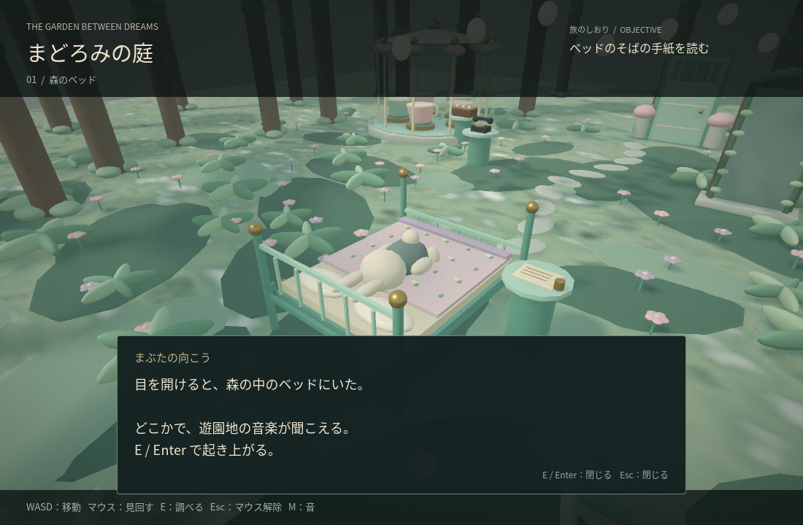
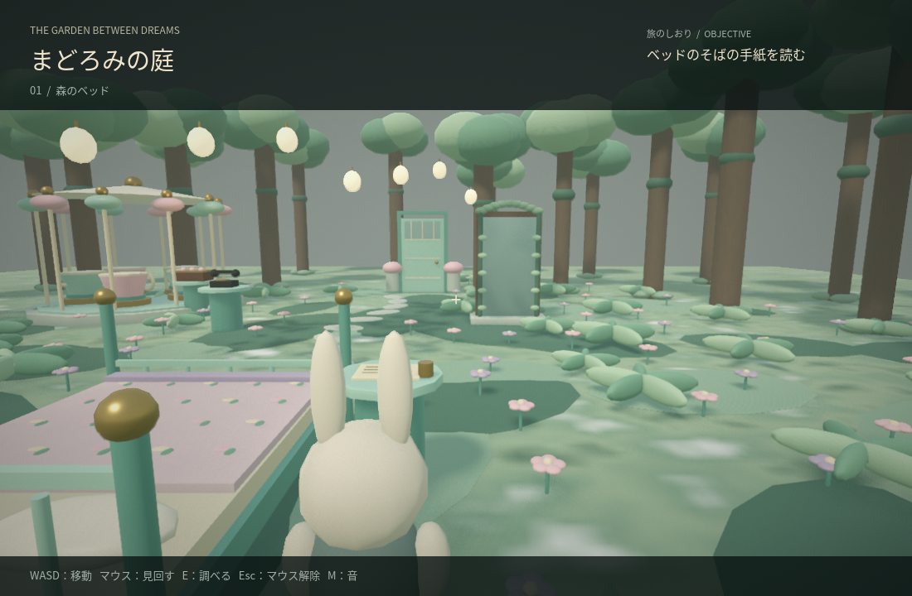
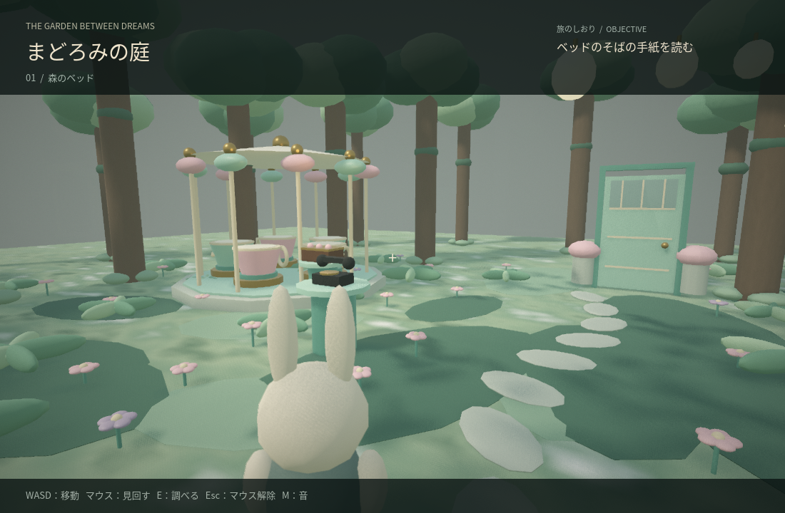

# まどろみの庭 / The Garden Between Dreams

森のベッドで目覚める、三人称視点のドリームコア探索ゲームです。ミントグリーン、淡いピンク、クリーム色の古い遊園地と、苔や花に囲まれた森を組み合わせたオリジナルのローポリゴン試作品です。

## 起動

Godot 4 の通常版で `project.godot` をインポートし、F5 で実行します。Godot 4.6.3 で検証しています。

```sh
godot --path .
```

最初はうさぎが森のベッドに横たわっています。E / Enter で起き上がると、キャラクターの少し後ろ・右側からの視点で探索できます。

## 操作

| キー | 操作 |
| --- | --- |
| WASD / 矢印 | 移動 |
| マウス | 周囲を見回す |
| E / Enter | 照準を合わせた近くの物を調べる・会話を閉じる |
| Esc | 会話を閉じる／探索中はマウスを解除 |
| 左クリック | マウスを再捕捉 |
| M | 音の切替 |
| R | エンディング後に最初から再開 |

ベッド脇の手紙を読み、森に置き去りにされた電話、苔の鏡、ティーカップのオルゴールを調べて、帰りの鍵を見つけます。画面右上に次の目的が表示されます。カメラは障害物に近づくと手前に寄ります。

## 検証

```sh
godot --headless --path . --script res://tests/smoke.gd
```

55項目で、ベッドでの目覚め、三人称への切替、手がかりの順序、対象への照準、鍵と扉、再開、移動・衝突、カメラ、UI を確認します。描画やOSのマウス捕捉は別途グラフィカル環境で確認します。

クラウドでホームに書き込めない場合:

```sh
mkdir -p /workspace/.runtime/{data,config,cache}
export XDG_DATA_HOME=/workspace/.runtime/data
export XDG_CONFIG_HOME=/workspace/.runtime/config
export XDG_CACHE_HOME=/workspace/.runtime/cache
godot --headless --path . --script res://tests/smoke.gd
```

## 画面







## 素材

モデル、花柄、苔のテクスチャ、音はコードで生成しています。参考写真や他作品の素材は含みません。Godot プロジェクト形式の配布で、単独実行ファイルは含みません。

## 光と影

標準の描画方式は **Forward+** です。曇り空からの環境光、柔らかい太陽の影、葉の透過形状による木漏れ日、SSAO による接地感、SSIL による周囲からの間接光、薄いボリューム霧を使用します。布・苔・樹皮の細かな凹凸と、金属や陶器の反射も調整しています。形状は引き続きローポリゴンです。

Forward+ に対応した GPU が必要です。起動できない場合や負荷を下げたい場合は、Godot の描画方式を Compatibility にするか、次のコマンドで起動します。Compatibility では SSAO・SSIL・ボリューム霧は使わず、空・影・素材・通常の霧で描画します。

```sh
godot --path . --rendering-method gl_compatibility
```

Linux クラウドでの Forward+ 描画検証には、作業領域へ展開した Mesa ソフトウェア Vulkan ドライバーを使用しました。これは配布 ZIP には含みません。手元の PC では通常、GPU のドライバーが使用されます。
